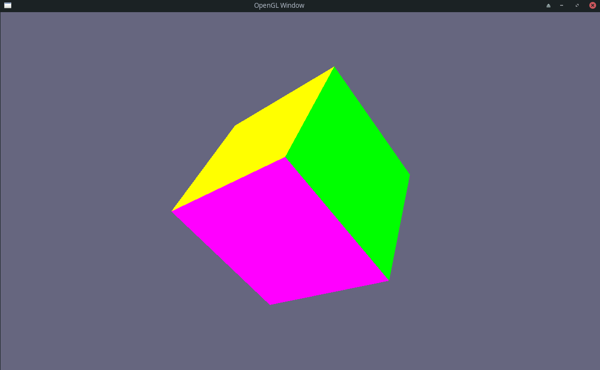

# FirstGameEngine

A modular 3D game engine built from scratch in **C++** using **OpenGL**, **GLFW**, and **GLEW**.

The engine is designed with modularity in mind, separating reusable engine code from game-specific logic. Each engine subsystem is compiled as its own static library, making the project easy to extend and maintain.



---

## Features

- Modern OpenGL rendering pipeline
- Modular engine architecture
- Scene and entity system
- First-person free camera
- Shader abstraction
- Texture loading
- OBJ mesh support
- Asset management system
- Keyboard and mouse input handling
- Delta-time movement
- Physics module *(work in progress)*
- AABB collision primitives
- CMake build system
- Static library separation for engine modules

---

## Project Structure

```text
FirstGameEngine/
├── core/
│   ├── AssetManager/
│   ├── Collision/
│   ├── Entity/
│   ├── Event/
│   ├── Game/
│   ├── Graphics/
│   │   ├── Camera/
│   │   ├── Mesh/
│   │   ├── Renderer/
│   │   │   ├── Shader/
│   │   │   ├── Texture/
│   │   │   ├── VAO/
│   │   │   ├── VBO/
│   │   │   └── EBO/
│   │   └── lib/
│   ├── Input/
│   ├── Logic/
│   ├── Physics/
│   ├── Scene/
│   └── Window/
│
├── gameApp/
│   ├── Camera/
│   ├── models/
│   ├── shader/
│   ├── textures/
│   ├── GameLogic.cpp
│   └── main.cpp
│
├── CMakeLists.txt
└── README.md
```

---

## Architecture

The engine is composed of independent modules that communicate through well-defined interfaces.

```
Application
      │
      ▼
    Game Loop
      │
 ┌────┴──────────────────────────┐
 │                               │
 ▼                               ▼
Input                         Scene
 │                               │
 ▼                               ▼
Events                      Entities
 │                               │
 └──────────────┬────────────────┘
                ▼
            Renderer
      ├── Shader
      ├── Texture
      ├── Mesh
      ├── VAO
      ├── VBO
      └── EBO
                │
                ▼
             OpenGL
```

Game-specific behavior is implemented by inheriting from the abstract `Logic` interface.

```cpp
class Logic
{
public:
    virtual void onUpdate() = 0;
    virtual void onRender() = 0;
};
```

The engine owns the game loop while the application provides the gameplay implementation.

---

## Rendering

The renderer currently provides abstractions for:

- Vertex Array Objects (VAO)
- Vertex Buffer Objects (VBO)
- Element Buffer Objects (EBO)
- GLSL shader management
- Texture loading
- Mesh rendering
- View and projection matrices

---

## Camera

The sample application includes a free-fly camera.

| Input | Action |
|-------|--------|
| **W / S** | Move forward / backward |
| **A / D** | Strafe left / right |
| **Q / E** | Move down / up |
| **Mouse** | Look around |
| **F** | Toggle cursor capture |
| **ESC** | Exit application |

---

## Asset Management

The engine includes an AssetManager responsible for loading and organizing assets.

Currently supported:

- GLSL shaders
- Textures
- OBJ models

---

## Physics

A dedicated physics module exists for future expansion.

Current functionality includes:

- Physics module
- AABB collision primitives

---

## Input System

The input system tracks multiple key states.

```cpp
enum KeyState
{
    KEY_RELEASED,
    KEY_PRESSED,
    KEY_HELD
};
```

Example usage:

```cpp
Input::isKeyPressed(GLFW_KEY_W);
Input::isKeyHeld(GLFW_KEY_W);

float deltaTime = Input::getDeltaTime();
```

---

## Dependencies

- OpenGL
- GLFW
- GLEW
- GLM
- stb_image
- CMake 3.24 or newer
- A C++23 compiler (MSVC, GCC, or Clang)

CMake fetches versioned GLFW 3.4, GLEW 2.2.0, and GLM 1.0.1 sources by default and builds them with the selected compiler. The pre-existing archives in `core/Graphics/lib/` are not used. The first configure requires network access.

To use installed packages instead, configure with `-DFERSA_FETCH_DEPENDENCIES=OFF`; packages must provide `glfw`, `GLEW::GLEW`, and `glm::glm` targets.

## Building

```sh
cmake -S . -B build -DCMAKE_BUILD_TYPE=Debug
cmake --build build --config Debug --parallel 2
```

On Linux, install OpenGL/X11 development packages first. For Ubuntu:

```sh
sudo apt-get install cmake ninja-build libgl1-mesa-dev libxrandr-dev libxinerama-dev libxcursor-dev libxi-dev
```

On Windows, use a developer terminal with Visual Studio C++ build tools, or configure a suitable CMake toolchain. Dependencies are compiled from source; no manually copied `.a` files are required.

## Running

Single-configuration builds (Linux, Ninja):

```sh
./build/gameApp/fersa
```

Visual Studio builds:

```powershell
.\build\gameApp\Debug\fersa.exe
```

Assets are copied into `assets/` beside the executable after the sample is linked. Launching via the executable path above also works from another working directory. A launcher that only supplies a bare executable name via PATH can explicitly set the asset location:

```sh
fersa --assets /path/to/assets
```

`--smoke-test` creates a hidden OpenGL window, renders three frames, and exits. Startup errors are printed to stderr and return a nonzero exit status.

## Runtime checks

```sh
ctest --test-dir build -C Debug --output-on-failure
```

Graphics tests require a working OpenGL 3.3 context. Linux CI runs them under Xvfb/Mesa:

```sh
xvfb-run -a ctest --test-dir build --output-on-failure
```

Checks cover initialization validation, multiple-window GLFW lifetime, running without application logic, bounded updates/rendering, releasing application logic with its context still current, idempotent GPU deletion, mesh index-buffer ownership, sample asset resolution from another directory, missing assets, and Linux startup without a display. Windows CI builds the engine and runs the display-independent missing-assets, scene-document, transform-control, play-session, and viewport-authoring checks; run the graphics checks locally with an OpenGL-capable driver.

## Scene editor

Builds include `fersa_editor`, a separate docking editor backed by Dear ImGui and ImGuizmo:

```sh
# Windows multi-configuration build
./build/editor/Debug/fersa_editor.exe
# Linux / Ninja build
./build/editor/fersa_editor
# Choose an initial project folder
fersa_editor --project /path/to/project
```

The initial project defaults to `project/` beside the editor's asset directory. File > New creates an empty scene in the current project. Save/Open use `.fersa.json` files; opening a scene makes its parent folder the project root. Save As copies the project's managed assets beside the new scene, including assets needed by undo history. Existing different asset files are preserved and cause a clear conflict error. Move a scene together with its `assets/` folder to move the project.

### Import and materials

Use **Import...** on Windows for the native multi-file picker, **Import path...** for a source path on any platform, or drop files from your file manager into the editor window. Supported formats are **OBJ**, **PNG/JPG/JPEG**, and **Lua**. Files are validated and copied into the project's asset folder; name collisions receive a suffix. Source files are kept intact. Rescan updates the browser after external changes.

Select an OBJ in Assets and press **Create object**, or drag it into the viewport. Imported models start with a plain white material. They are framed automatically; **F** frames the selected object again. OBJ supports triangle/convex-polygon faces, positive/negative indices, optional UVs, and supplied or generated normals. Materials from MTL files are not imported; use the inspector to choose a texture and tint.

Apply a texture through the Material inspector, the asset's **Apply texture** button, or by dragging the image onto an object in the viewport. Material controls include tint, UV tiling, and a preview. Brick and plain-white built-ins are available. RGBA decoding handles grayscale/alpha and odd-width images consistently; very low alpha is treated as a cutout, rather than blended transparency.

### Object scripts

Select an object and use **New script**, or attach an imported Lua asset in the Script inspector. **Edit script** opens the in-app source editor. Save validates Lua syntax before replacing the file. Script changes reload on the next Play; source edits have their own unsaved-change prompt and are separate from scene undo. Attachments and material changes participate in scene undo/redo.

```lua
return {
    on_start = function(self)
        self.speed = 45
    end,
    on_update = function(self, dt)
        self.rotation.y = self.rotation.y + self.speed * dt
    end
}
```

Scripts run only in Play, on the runtime scene copy, and can edit their object's position, rotation, scale, and velocity. Each object has private Lua state and persistent custom `self` fields. The asset panel's Script console displays prints/errors. See [SCRIPTING.md](SCRIPTING.md) for the API and runtime limits.

### Authoring controls

Select through Hierarchy or click an object's transformed bounds in the viewport. Gold outlines mark selection. Use Move/Rotate/Scale or **W/E/R**, drag gizmo handles, or edit transform fields (Ctrl+click for numeric input). Move/Rotate offer local/world axes; Scale remains local and positive. Hold **RMB + WASD** to fly, **Q/E** for vertical movement, and Shift for speed. Tool shortcuts stay out of active text fields and RMB navigation.

**Ctrl+S / Ctrl+Shift+S / Ctrl+O / Ctrl+N** save, Save As, open, or start a scene. Dirty markers and Save/Discard/Cancel protect unsaved scenes. Failed opens leave the current scene intact; failed saves preserve dirty state and prior scene data. Scene format v2 stores imported asset references, tint/tiling, scripts, IDs, transforms, and physics. Version 1 remains readable. See [SCENE-FORMAT.md](SCENE-FORMAT.md).

**Edit > Undo/Redo** or **Ctrl+Z / Ctrl+Y / Ctrl+Shift+Z** restores create/duplicate/delete, names, transforms, resets, material/script attachments, and physics edits. A complete gesture/text edit is one action. Selection/camera navigation are not actions; active text fields retain local undo. Save preserves history; New/Open reset it. History is session-only, bounded to 100 snapshots and an approximate 32 MiB budget plus the saved checkpoint. Script-file edits and asset imports are not scene-history actions.

**Play/Pause/Step/Stop** uses a disposable scene copy. Lua updates and physics tick at 120 Hz, with at most eight catch-up steps per frame. Pause freezes both; Step runs one tick; Stop restores authored transforms and script state. Mass zero is static for physics; set positive mass and gravity to simulate a falling body. Scripts can directly animate static objects too. Object editing, importing, and saving are disabled during Play. The legacy runtime sample retains its original variable update timing.

### Dependencies and checks

ImGui is pinned to `v1.92.0-docking`, ImGuizmo to `105e4fde45e4e74aae8973d98750820ef7aca7e2`, nlohmann/json to `v3.11.3`, and Lua to `5.4.9` with a checked SHA-256. The runtime core has no editor/Lua UI dependency. Use `-DFERSA_BUILD_EDITOR=OFF` for runtime only. Offline sources can be supplied with `FERSA_IMGUI_SOURCE_DIR`, `FETCHCONTENT_SOURCE_DIR_IMGUIZMO`, `FETCHCONTENT_SOURCE_DIR_NLOHMANN_JSON`, and `FETCHCONTENT_SOURCE_DIR_LUA_SOURCE`. `FERSA_FETCH_DEPENDENCIES=OFF` controls only GLFW/GLEW/GLM.

The editor accepts `--assets DIRECTORY`, `--project DIRECTORY`, and `--smoke-test`. Tests cover runtime/GL resources, image upload formats, OBJ/import validation, portable copies/conflicts, scene migration, Lua callbacks/isolation/limits, Play isolation, viewport math, transforms, and undo/redo. Linux CI uses Xvfb/Mesa for rendering; Windows CI also runs the display-independent import/script checks. General mesh picking uses transformed bounds, not individual triangles. See [EDITOR-MVP.md](EDITOR-MVP.md) for the roadmap.

---

## Creating a Game

Create a class derived from `Core::Logic`.

```cpp
class MyGame : public Core::Logic
{
public:
    void onUpdate() override;
    void onRender() override;
};
```

Then register it with the engine.

```cpp
#include "core/Game/Game.hpp"
#include "MyGame.hpp"

int main()
{
    Core::GameSpecs specs;

    specs.title = "My Game";
    specs.windowSpec.width = 1280;
    specs.windowSpec.height = 720;

    Core::Game game(specs);

    game.pushLogic<MyGame>();

    game.run();
}
```
