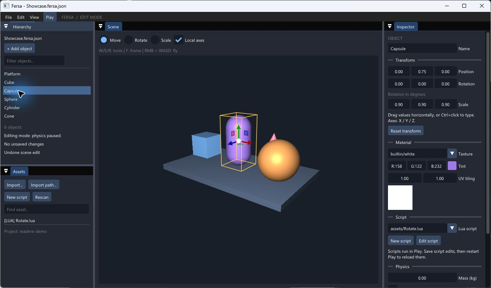
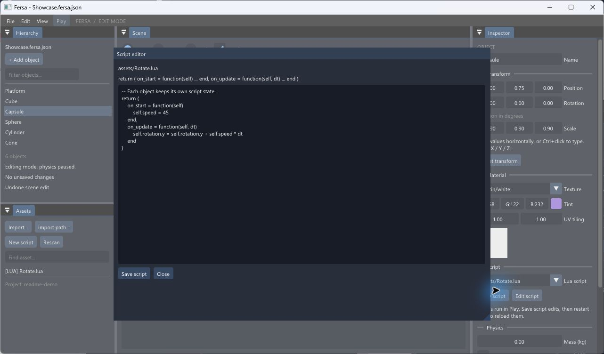

# Fersa · FirstGameEngine

A work-in-progress **3D engine and visual scene editor**, built from scratch in
C++23 and OpenGL. Build scenes with primitives or imported models, assign materials
and Lua scripts, and test them in an isolated Play session.



## What you can do

- **Build scenes visually:** dockable Hierarchy, Assets, viewport, and Inspector;
  object filtering, viewport selection, selection outlines, and transform gizmos.
- **Create primitives:** cube, vertical square, ground plane, sphere, cylinder,
  cone, and capsule (bean). New objects get unique names, automatic selection,
  and nearby placement slots in front of the camera.
- **Import assets:** OBJ models, PNG/JPEG textures, and Lua scripts through the
  Windows multi-file picker, path entry, or file drops. Imports are validated
  and copied into the project without changing the originals.
- **Edit materials:** one texture per object, tint, UV tiling, and image preview.
- **Script objects:** attach Lua scripts, edit source in the editor, and use
  `on_start(self)` / `on_update(self, dt)` with private per-object state.
- **Preview safely:** Play/Pause/Step/Stop runs scripts and physics on a scene
  copy. Stop restores the authored scene. Physics uses a fixed 120 Hz step.
- **Save your work:** portable `.fersa.json` scenes, managed asset copies on
  Save As, unsaved-change prompts, and undo/redo for scene edits.
- **Explore the core:** modular rendering, resource ownership, input, scene/entity
  management, and simple AABB physics, separate from the editor application.

## Try the Windows preview

Open [Windows preview package runs](https://github.com/matheusCsousa/FirstGameEngine/actions/workflows/package.yml),
choose a successful run, and download **Fersa-Editor-Windows-x64** from Artifacts.
GitHub requires signing in to download workflow artifacts, which have limited
retention. If the artifact download wraps another ZIP, extract that ZIP too.

Extract the complete editor package into a writable folder and run
**`fersa_editor.exe`**. Keep `assets/` and `licenses/` beside it. No compiler or
Python installation is needed. Requires Windows 10/11 x64 and an OpenGL 3.3
capable graphics driver. The preview executable is unsigned.

The workflow builds preview artifacts; it does **not** automatically publish a
GitHub Release. See [RELEASE-README.txt](RELEASE-README.txt) for launch instructions.

## Editor workflow

1. Use **+ Add object** in Hierarchy, or select an imported OBJ in Assets and
   choose **Create object**. Models can also be dragged into the viewport.
2. Select an object in Hierarchy or click its bounds in the viewport. Use the
   gizmo or Inspector to edit position, rotation, scale, materials, and physics.
3. Attach a Lua asset or choose **New script**, then **Edit script**. Save the
   source before starting Play. Script changes reload on the next Play session.
4. Use **Play**, **Pause**, **Step**, and **Stop** to test. Object editing,
   importing, and saving are disabled during Play.
5. Save the scene. **Save As** copies the managed asset library next to the new
   scene, preserving conflicting destination files with an error.

The default project is `project/` beside the editor executable's asset directory.
**File > New** creates an empty scene in the current project. Opening a scene
uses its parent folder as the project root. Move the scene and its `assets/`
folder together. Existing version 1 scenes remain readable; new saves use version 2.

### Controls

| Input | Editor action |
| --- | --- |
| W / E / R | Move / rotate / scale tool |
| F, while pointing at the viewport | Frame selected object |
| Right mouse + W/A/S/D | Look around and fly |
| Right mouse + Q/E | Move down / up |
| Shift during navigation | Move faster |
| Ctrl+click a numeric field | Type an exact value |
| Ctrl+S / Ctrl+Shift+S | Save / Save As |
| Ctrl+O / Ctrl+N | Open / new scene |
| Ctrl+Z / Ctrl+Y or Ctrl+Shift+Z | Undo / redo |
| View > Reset workspace layout | Restore the default dock arrangement |

Move and Rotate offer local/world axes. Scale stays local and positive.
Shortcuts respect active text fields and viewport navigation. Undo/redo covers
scene edits, including material and script attachments; asset imports and script
source edits are separate operations. History is session-only and bounded.

### Lua object scripts



```lua
return {
    on_start = function(self)
        self.speed = 45
    end,
    on_update = function(self, dt)
        self.rotation.y = self.rotation.y + self.speed * dt
    end
}
```

Scripts can edit their object's position, rotation, scale, and velocity. Each
object has isolated globals and persistent custom `self` fields. Prints and
errors appear in the Script console; a failed script is disabled for the session.
Source, object count, memory, and VM instruction limits are enforced. This is a
local authoring feature, not a security boundary for hostile scripts.

See [SCRIPTING.md](SCRIPTING.md) for the API and limits, and
[SCENE-FORMAT.md](SCENE-FORMAT.md) for project persistence.

## Build from source

Requires CMake 3.24+, a C/C++23 compiler, and OpenGL development support.
The first configure downloads pinned dependencies. On Windows, use a Visual
Studio developer terminal with the C++ build tools installed:

```powershell
git clone https://github.com/matheusCsousa/FirstGameEngine.git
cd FirstGameEngine
cmake -S . -B build -A x64
cmake --build build --config Release --parallel 2
.\build\editor\Release\fersa_editor.exe
```

On Ubuntu, install the development packages, then build with Ninja:

```sh
sudo apt-get install cmake ninja-build g++ libgl1-mesa-dev libxrandr-dev libxinerama-dev libxcursor-dev libxi-dev
cmake -S . -B build -G Ninja -DCMAKE_BUILD_TYPE=Release
cmake --build build --parallel 2
./build/editor/fersa_editor
```

For a portable package after building:

```sh
cpack --config build/CPackConfig.cmake -C Release -B dist
```

The editor accepts `--project DIRECTORY`, `--assets DIRECTORY`, and
`--smoke-test` (a hidden window that renders three frames and exits).

### Dependencies

CMake fetches GLFW 3.4, GLEW 2.2.0, GLM 1.0.1, Dear ImGui
`v1.92.0-docking`, ImGuizmo `105e4fde45e4e74aae8973d98750820ef7aca7e2`,
nlohmann/json 3.11.3, and Lua 5.4.9 (SHA-256 checked). Texture decoding uses
stb_image. Third-party notices are included in the portable package.

`-DFERSA_BUILD_EDITOR=OFF` builds the runtime sample alone. Its executable is
`build/gameApp/fersa` (Ninja/Linux) or `build/gameApp/Release/fersa.exe` (Visual
Studio). The sample has its own camera controls and variable update timing.

`-DFERSA_FETCH_DEPENDENCIES=OFF` uses installed GLFW/GLEW/GLM packages with
`glfw`, `GLEW::GLEW`, and `glm::glm` targets. Editor dependency source overrides
include `FERSA_IMGUI_SOURCE_DIR`, `FETCHCONTENT_SOURCE_DIR_IMGUIZMO`,
`FETCHCONTENT_SOURCE_DIR_NLOHMANN_JSON`, and `FETCHCONTENT_SOURCE_DIR_LUA_SOURCE`.
The old prebuilt archives under `core/Graphics/lib/` are not used.

## Architecture

```text
core/       Reusable engine modules: rendering, resources, scenes, entities,
            input, window lifecycle, collision, and physics
editor/     Docking UI, authoring tools, scene documents, asset library,
            Lua runtime, and isolated Play sessions
gameApp/    Standalone runtime sample and built-in assets
tests/      Runtime, graphics, persistence, authoring, asset, and script checks
scripts/    Reproducible primitive mesh generator
cmake/      Dependency configuration
```

The application supplies a `Core::Logic` implementation; `Core::Game` owns the
window and game loop. Core modules compile into static libraries. The editor
and its Lua/UI integrations are separate from the runtime core.

## Validation

```sh
ctest --test-dir build -C Release --output-on-failure
```

Graphics checks need an OpenGL 3.3 context. Linux CI uses Xvfb/Mesa
(`xvfb-run -a ctest --test-dir build --output-on-failure`); Windows CI runs the
display-independent tests. Checks cover runtime/GL lifetimes, texture uploads,
OBJ validation, primitive geometry, scene migration, portable asset copies,
transform math, undo/redo, Play isolation, and Lua callbacks/resource limits.

## Current limits

- An experimental editor, not a complete production engine or a Godot clone.
- Squares and planes are flat 3D meshes; there is no separate 2D editor.
- Physics and selection use bounding boxes, including for curved meshes.
- One material/texture and one script per object. OBJ only: no MTL material
  import, FBX/glTF, skeletal animation, or blended transparency.
- Scripts currently operate on their own object; input, spawning, scene queries,
  and collision callbacks are future work. Script edits reload on the next Play.
- Rescan refreshes the asset list; cached mesh/texture resources do not hot-reload.
- Scene Open/Save uses path entry; the native file picker is for asset imports.

See [EDITOR-MVP.md](EDITOR-MVP.md) for the editor roadmap.
